<!--
  Maintainer notes (not rendered on GitHub):
  - PromptBase links must always carry the referral parameter ?via=bentleyartdesign
  - Agensi skill links are direct skill URLs (all 3 approved 2026-10-11).
  - TODO(promptbase-links, optional): swap the store link on each prompt card for that prompt's own
    PromptBase URL, keeping ?via=bentleyartdesign on the end.
  - TODO(repo-url): install commands assume github.com/DuncanBentley/bentley-art-design. Update them if
    the repository gets a different name.
-->

<p align="center">
  <a href="https://promptbase.com/profile/bentleyartdesign?via=bentleyartdesign">
    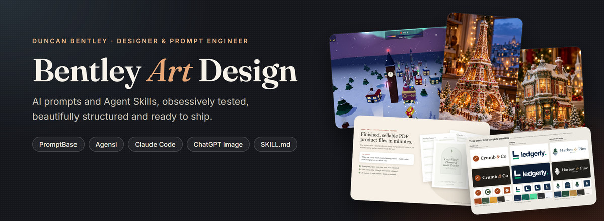
  </a>
</p>

<h1 align="center">Bentley Art Design</h1>

<p align="center">
  <b>Designer-built AI prompts and Agent Skills.</b><br>
  Obsessively tested, beautifully structured, ready to ship.
</p>

<p align="center">
  <a href="https://promptbase.com/profile/bentleyartdesign?via=bentleyartdesign"></a>
  <a href="https://www.agensi.io/creators/duncan-bentley"></a>
  <a href="#free-skills"></a>
</p>

<p align="center">
  <a href="#agent-skills-on-agensi">Agent Skills</a> &nbsp;·&nbsp;
  <a href="#prompts-on-promptbase">Prompts</a> &nbsp;·&nbsp;
  <a href="#free-skills">Free skills</a> &nbsp;·&nbsp;
  <a href="#install-the-free-skills">Install</a> &nbsp;·&nbsp;
  <a href="#license">License</a>
</p>

## About Duncan

I'm **Duncan Bentley**, the designer and prompt engineer behind **Bentley Art Design**. I build AI
prompts and Agent Skills the way I build design work: nothing ships until it has been run, looked at
and checked. This repository is my shop window, plus two small free skills you can use today.

<table>
  <tr>
    <td width="33%" valign="top">
      <b>Obsessively tested</b><br>
      Game prompts are built end to end and played in a real browser before they are listed.
      Every skill ships scripts that check their own output.
    </td>
    <td width="33%" valign="top">
      <b>Beautifully structured</b><br>
      Clear variables, buyer instructions and step-by-step SKILL.md workflows, so good results are
      repeatable instead of lucky.
    </td>
    <td width="33%" valign="top">
      <b>Ready to ship</b><br>
      Files, not advice: playable HTML games, print-ready PDFs, SVG logo systems, design tokens and
      validated product listings.
    </td>
  </tr>
</table>

---

## Agent Skills on Agensi

Agent Skills are SKILL.md packages with tested helper scripts. They are built and tested in Claude
Code and made for any SKILL.md-compatible agent that can run Python (Codex CLI, Cursor and others),
and they turn one request into finished, validated files.

<sub>All three skills are live on Agensi (approved 2026-10-11). More on the <a href="https://www.agensi.io/creators/duncan-bentley">creator page</a>.</sub>

### Digital Product Factory: Print-Ready PDF Packs + Listing


**Finished, sellable PDF product files in minutes.** Tell your agent *"Make me a cozy 2027 undated
weekly planner + habit tracker pack in sage green"* and get a designed, multi-page vector PDF pack in
US Letter and A4, a sales listing and an upload-ready ZIP.

- **28 page layouts**: weekly, daily and monthly planners, habit and budget trackers, meal plans, chore charts, handwriting worksheets, reading logs, Christmas and wedding planners and more
- **9 style presets** (sage, minimal, boho, pastel, bold modern, vintage, Christmas, kids, ocean) or your own brand color
- **Dated or undated**: real calendars for any year, Monday or Sunday start, bookmarks
- **Print-safe**: every element checked against a 0.25 in safe zone; PDF and listing validators on every build
- **Listing pack**: title, 13 tags, description and preview slides made from your real pages
- Python standard library only: no installs, no API keys, no network

<p align="center">
  <a href="https://www.agensi.io/skills/digital-product-factory-print-ready-pdf-packs-listing">
    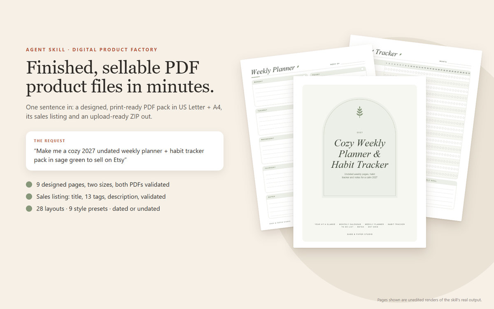
  </a>
</p>

<table>
  <tr>
    <td align="center" width="50%">
      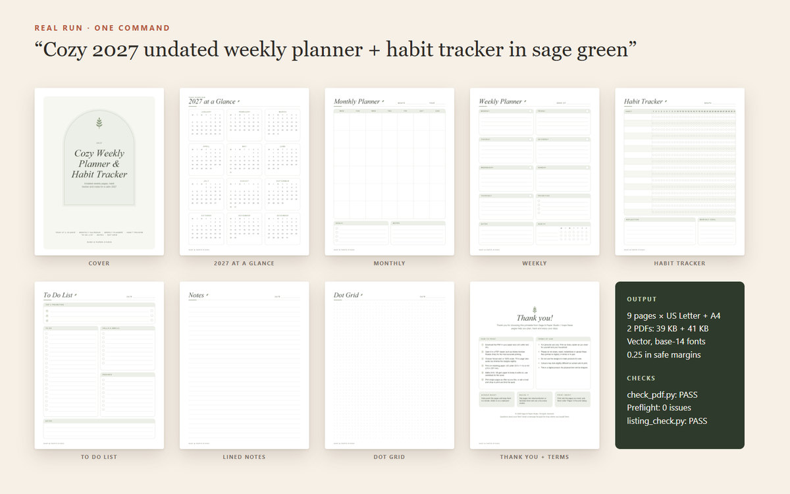<br>
      <sub>A full 9-page pack from one sentence</sub>
    </td>
    <td align="center" width="50%">
      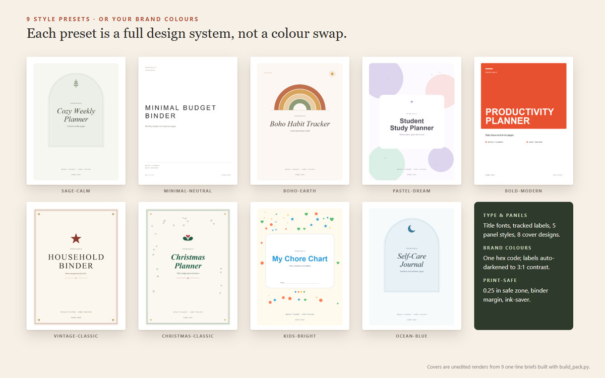<br>
      <sub>9 style presets, each a full design system</sub>
    </td>
  </tr>
  <tr>
    <td align="center" width="50%">
      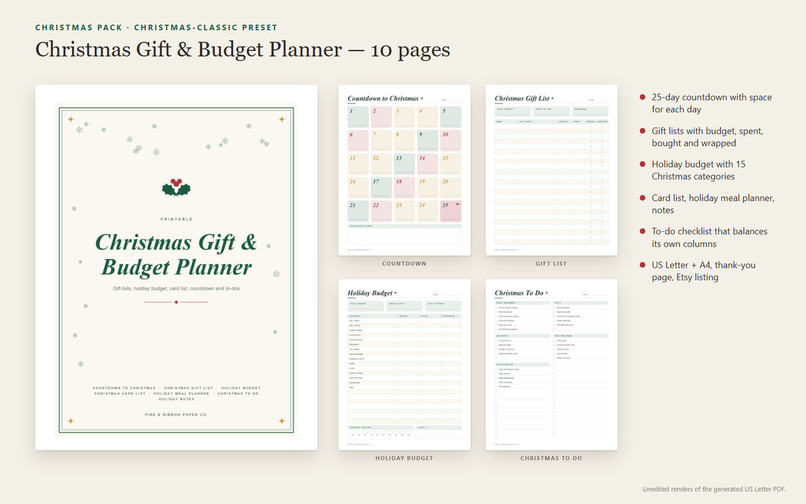<br>
      <sub>Seasonal products: a 10-page Christmas planner</sub>
    </td>
    <td align="center" width="50%">
      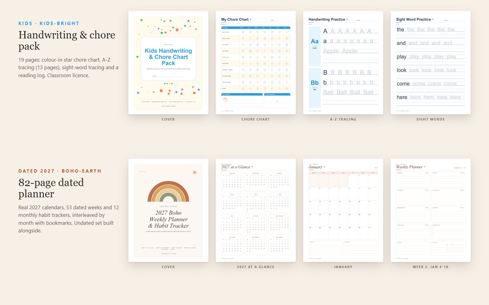<br>
      <sub>Kids worksheets and an 82-page dated planner</sub>
    </td>
  </tr>
</table>

<p align="center">
  <a href="https://www.agensi.io/skills/digital-product-factory-print-ready-pdf-packs-listing"><b>Get Digital Product Factory on Agensi &rarr;</b></a>
</p>

### Design System Starter: Logos, WCAG Palette + Tailwind Tokens


**A brand kit and design system from one paragraph.** Describe a business; your agent runs a
designer's process and hands over a validated `brand/` folder you can use the same day.

- **17 SVG logo files**: wordmark, monogram, symbol, horizontal and stacked lockups, reversed and one-color versions, an adaptive favicon and a social avatar
- **WCAG-checked palette**: perceptually even 50-950 scales and a contrast matrix where every failing pair gets the nearest passing fix
- **Design tokens in 4 formats**: CSS variables with dark mode, Tailwind v4 `@theme`, Tailwind v3 config and W3C DTCG JSON
- **guidelines.html** that prints to an A4 PDF, plus a brand voice sheet with taglines and bios
- **Validated before hand-over**: SVG lint and a kit check that must say READY
- Python standard library only: no installs, no API keys, no network

<p align="center">
  <a href="https://www.agensi.io/skills/design-system-starter-logos-wcag-palette-tailwind-tokens">
    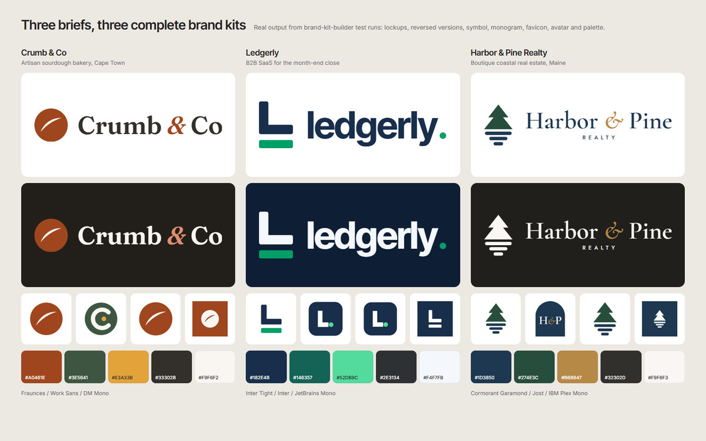
  </a>
</p>

<table>
  <tr>
    <td align="center" width="50%">
      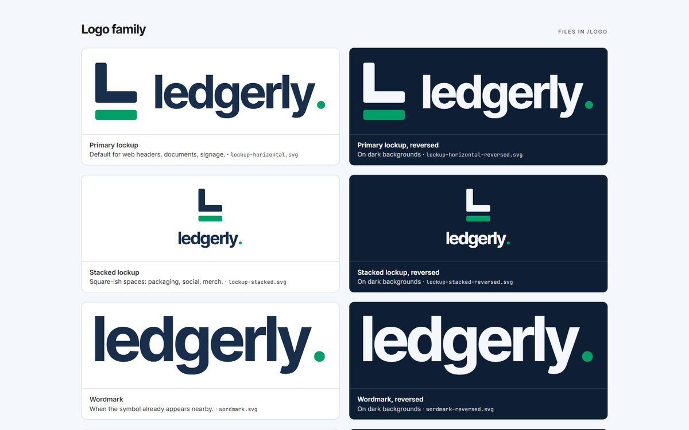<br>
      <sub>A complete logo family, reversed versions included</sub>
    </td>
    <td align="center" width="50%">
      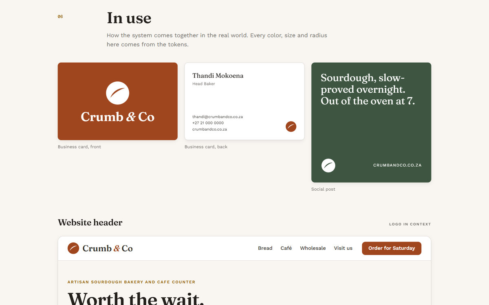<br>
      <sub>Guidelines with the brand in use</sub>
    </td>
  </tr>
  <tr>
    <td align="center" width="50%">
      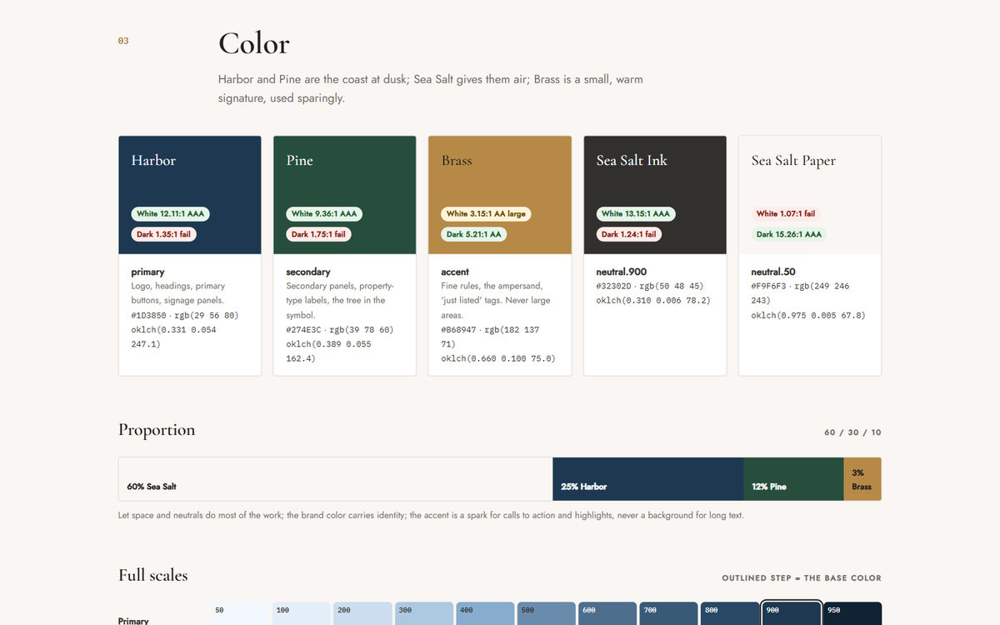<br>
      <sub>Color roles, proportions and full scales</sub>
    </td>
    <td align="center" width="50%">
      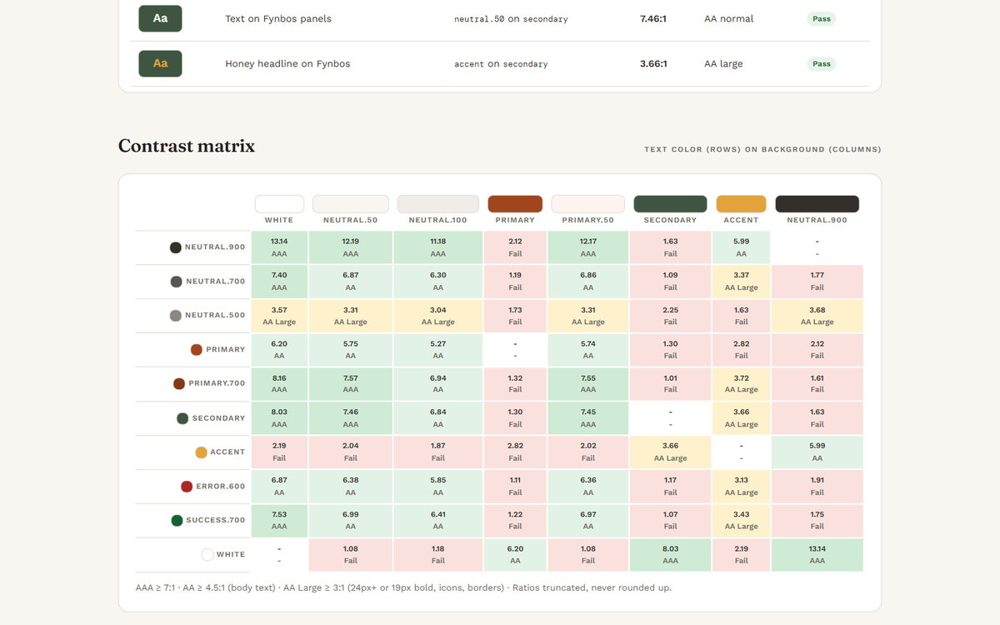<br>
      <sub>Every pairing checked against WCAG 2.x</sub>
    </td>
  </tr>
</table>

<p align="center">
  <a href="https://www.agensi.io/skills/design-system-starter-logos-wcag-palette-tailwind-tokens"><b>Get Design System Starter on Agensi &rarr;</b></a>
</p>

### Beat Drop Reels: Beat-Synced 9:16 Promo Videos From Photos


**Product photos + a logo + a song in, a finished 1080x1920 promo MP4 out, with every cut on the beat.**
Your agent maps the music (tempo, beat grid, the drop), renders the reel frame by frame and then proves the sync:
a built-in check re-measures the beat from the finished video and reports where every cut lands.

- **4 reel formats**: product drop, SOLD OUT &rarr; RESTOCKED, countdown teaser + reveal, event promo
- **3 looks**: bold (streetwear / merch), clean (premium DTC), neon (nightlife / events)
- **Platform-ready**: H.264, 30 fps, AAC at -14 LUFS, faststart, safe-zone aware text, optional size cap
- **Your real images only**: nothing generated or hallucinated

<p align="center">
  <a href="https://www.agensi.io/skills/beat-drop-reels-beat-synced-9-16-promo-videos-from-photos">
    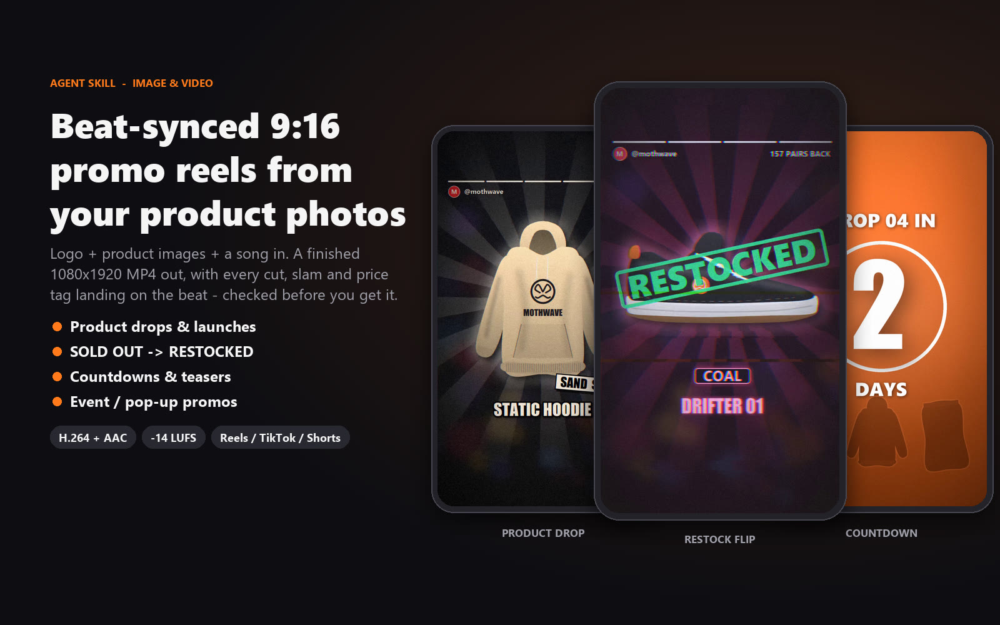
  </a>
</p>

<table>
  <tr>
    <td align="center" width="50%">
      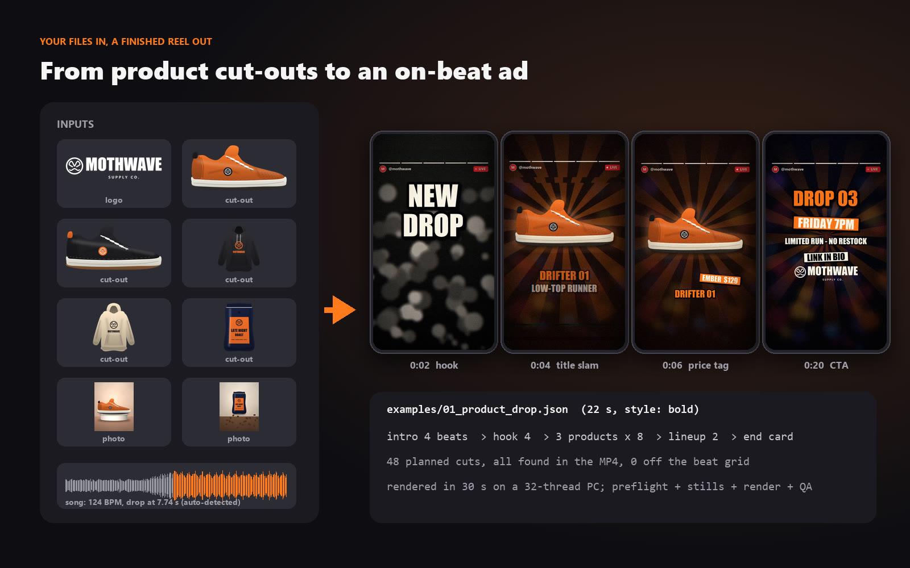<br>
      <sub>Your photos, logo and song become a finished reel</sub>
    </td>
    <td align="center" width="50%">
      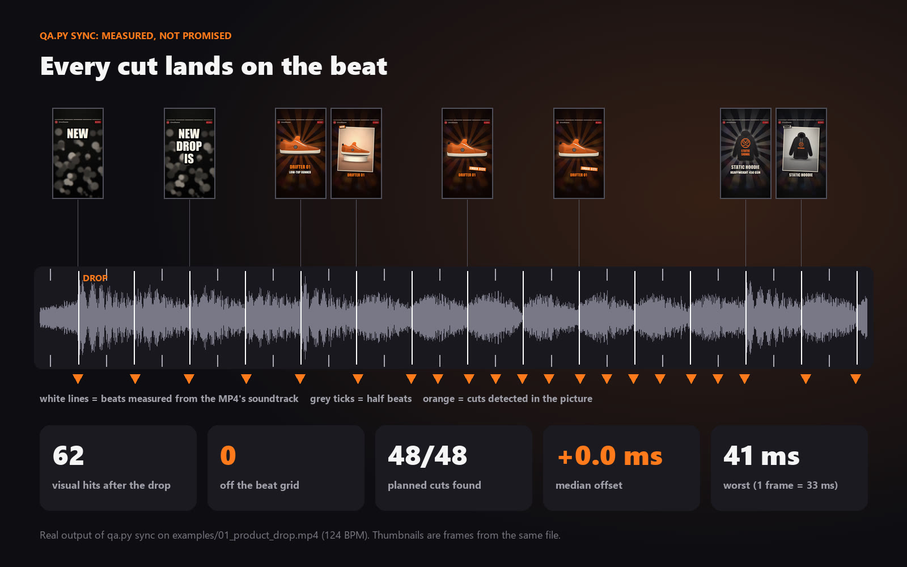<br>
      <sub>Cuts measured against the beat grid</sub>
    </td>
  </tr>
</table>

<p align="center">
  <a href="https://www.agensi.io/skills/beat-drop-reels-beat-synced-9-16-promo-videos-from-photos"><b>Get Beat Drop Reels on Agensi &rarr;</b></a>
</p>

---

## Prompts on PromptBase

Prompts for Claude Code and ChatGPT Image, each with clear `[VARIABLES]`, buyer instructions and
real example outputs. All of them live in one store:

<p align="center">
  <a href="https://promptbase.com/profile/bentleyartdesign?via=bentleyartdesign"><b>Browse the Bentley Art Design store on PromptBase &rarr;</b></a>
</p>

### Claude Code game builders

One prompt, one complete 3D browser game: a single self-contained `index.html` built with Three.js,
with every model, sound effect and music loop generated in code. Edit the theme variables to re-skin it.

<table>
  <tr>
    <td width="50%" valign="top">
      <a href="https://promptbase.com/profile/bentleyartdesign?via=bentleyartdesign"><!-- TODO(promptbase-links): sleigh prompt URL -->
        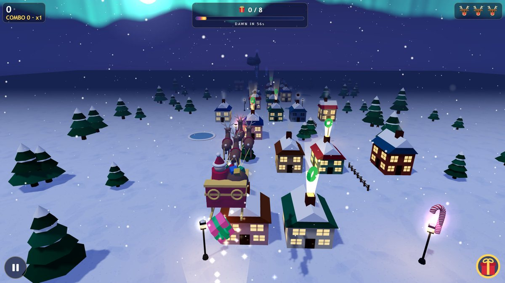
      </a>
      <h4>3D Santa Sleigh Delivery Game Builder</h4>
      <p>Fly Santa's sleigh over an endless snowy village and drop presents in a physics arc into glowing chimneys. Nights get faster and harder, with steeples, clock towers, owls and storm clouds to dodge, plus power-ups, combos, a title screen and a saved high score.</p>
      <p><sub>Claude Code &middot; keyboard and touch &middot; re-skin with [THEME], [HERO], [GIFT]</sub></p>
      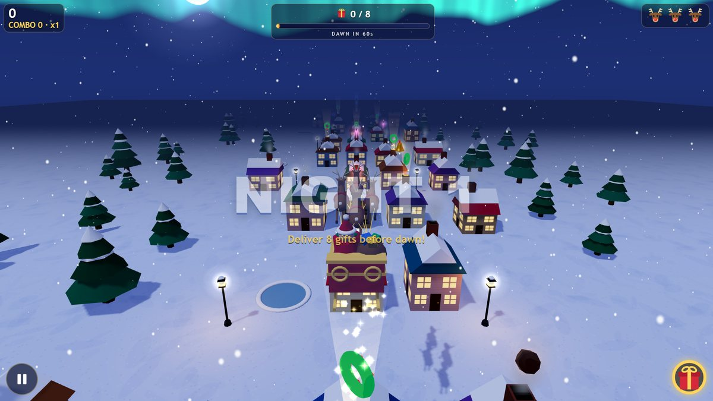
      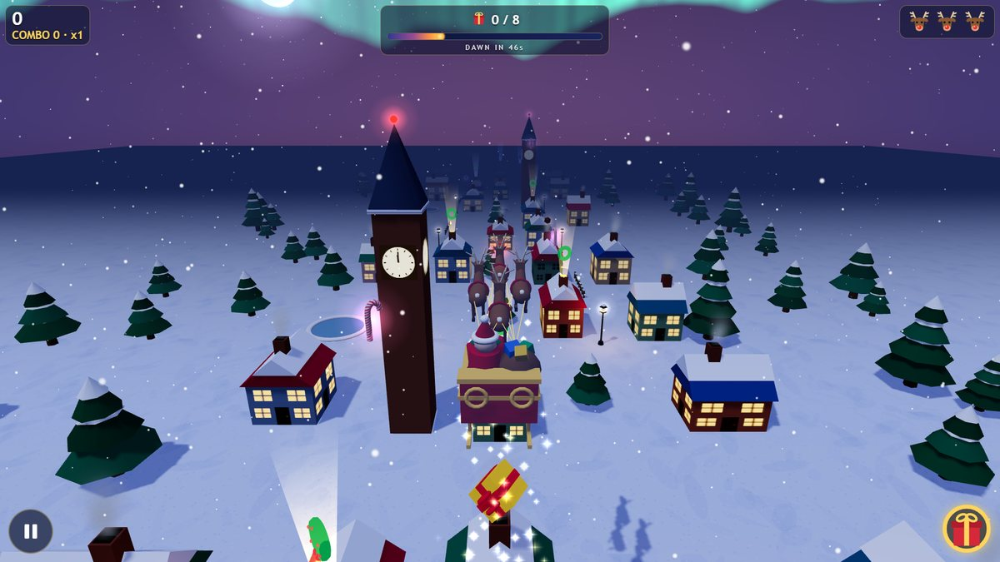
    </td>
    <td width="50%" valign="top">
      <a href="https://promptbase.com/profile/bentleyartdesign?via=bentleyartdesign"><!-- TODO(promptbase-links): snowball prompt URL; confirm the listing is live -->
        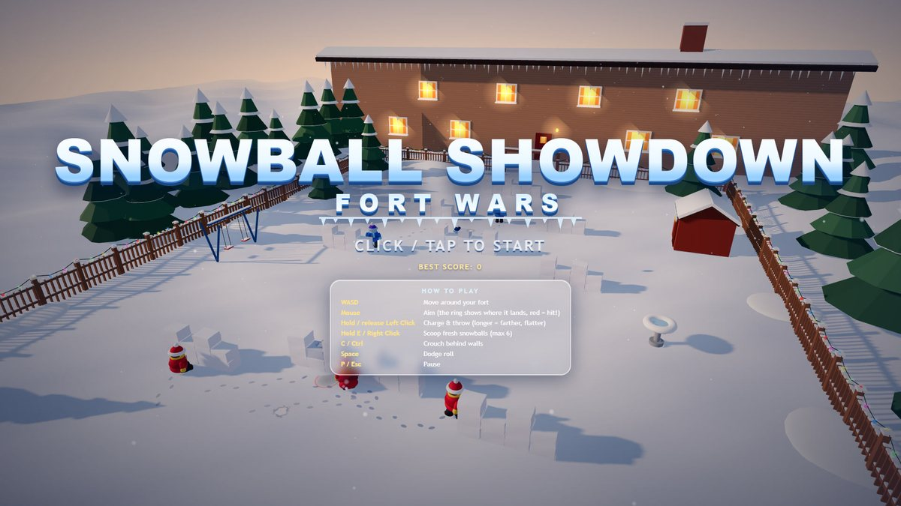
      </a>
      <h4>3D Snowball Fight Arena Game Builder</h4>
      <p>Defend your snow fort against waves of rival kids: charge and aim arcing throws, duck behind crumbling walls, scoop fresh ammo, dodge-roll, and rebuild or buy upgrades between waves. Four enemy types and a giant snowman boss.</p>
      <p><sub>Claude Code &middot; mouse and touch &middot; re-skin with [THEME], [HERO], [ENEMIES]</sub></p>
      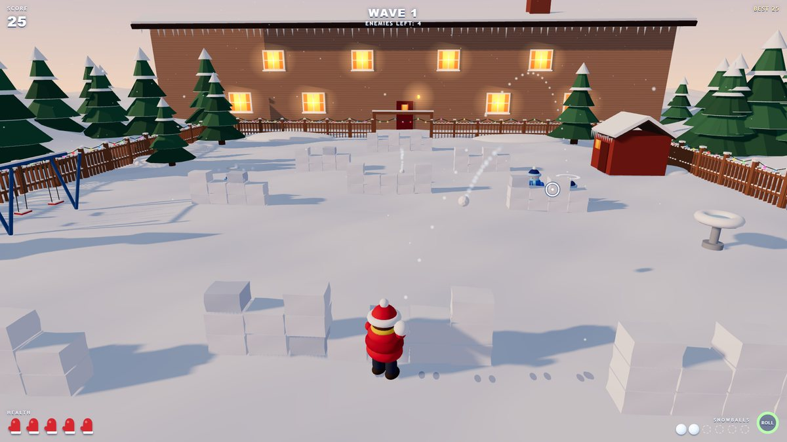
      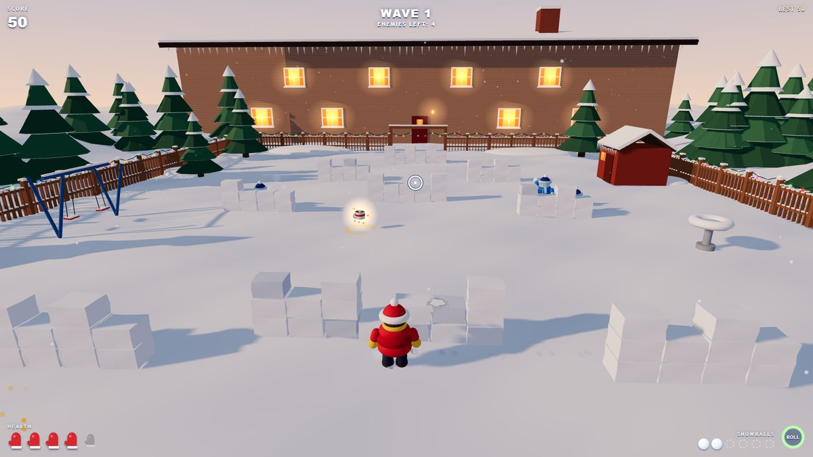
    </td>
  </tr>
</table>

### Gingerbread Replicas Of Any Building

*ChatGPT Image.* Turn any building, landmark or vehicle into a showpiece gingerbread photo: crisp
baked panels, piped royal icing, glowing sugar-glass windows and a tiny edible village, shot like
premium food photography. Your home, a client's house, a shop front, a castle or a steam train.
Made for realtor and business holiday cards, Christmas posts, gifts and wall art.

<table>
  <tr>
    <td align="center"></td>
    <td align="center"></td>
    <td align="center">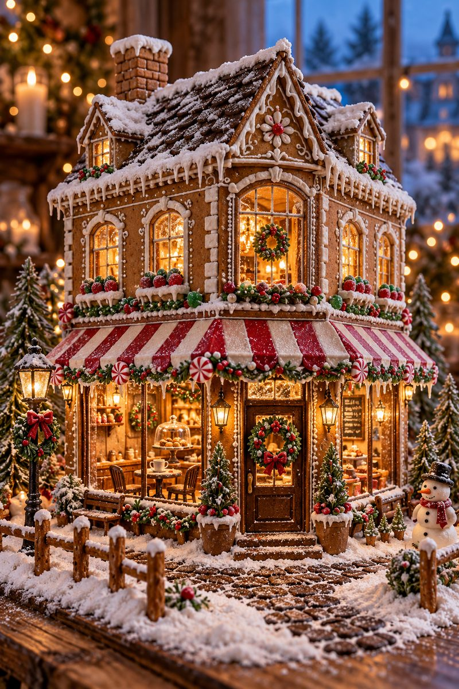</td>
  </tr>
  <tr>
    <td align="center"></td>
    <td align="center"></td>
    <td align="center"></td>
  </tr>
</table>

<p align="center">
  <a href="https://promptbase.com/profile/bentleyartdesign?via=bentleyartdesign"><b>Get Gingerbread Replicas on PromptBase &rarr;</b></a><!-- TODO(promptbase-links): gingerbread prompt URL -->
</p>

### Porcelain Christmas Village Replicas

*ChatGPT Image.* Turn any building into a collectible light-up porcelain Christmas village piece:
glossy hand-painted glaze, sculpted sparkling snow, glowing amber windows, tiny figurines and a blank
name plaque, shot like a collectibles catalogue. Choose the building, the figures, the display spot
and the color palette.

<table>
  <tr>
    <td align="center">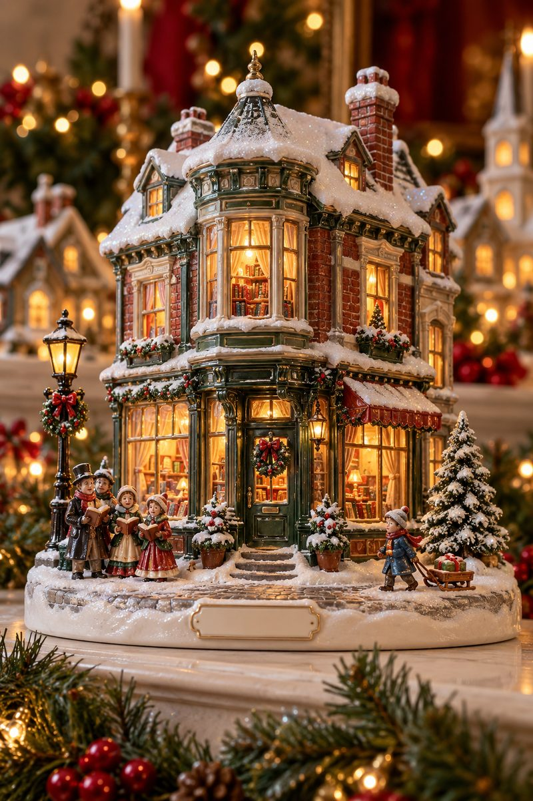</td>
    <td align="center">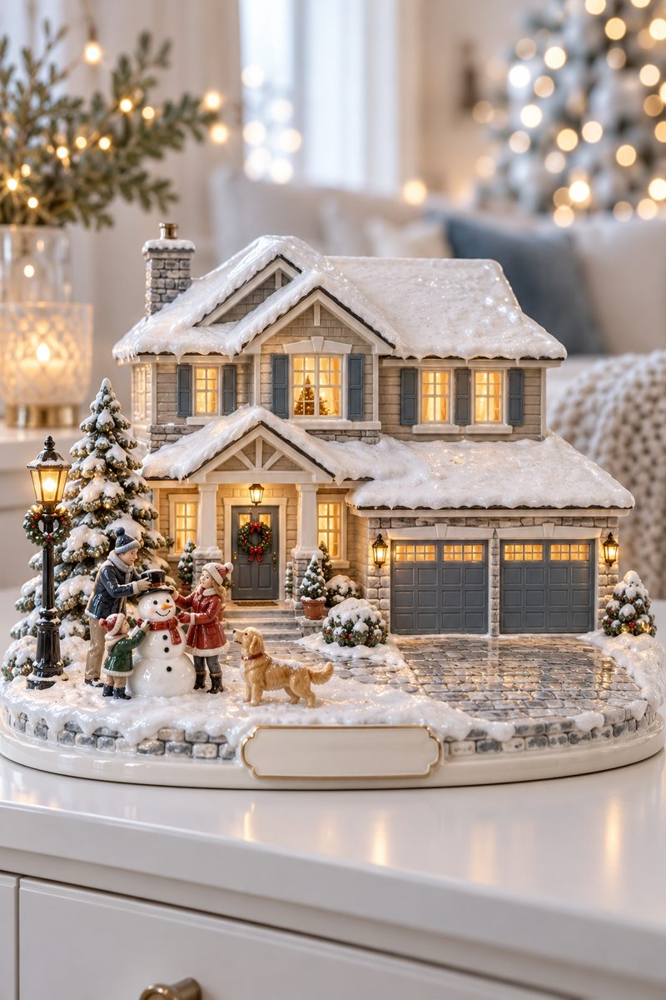</td>
    <td align="center">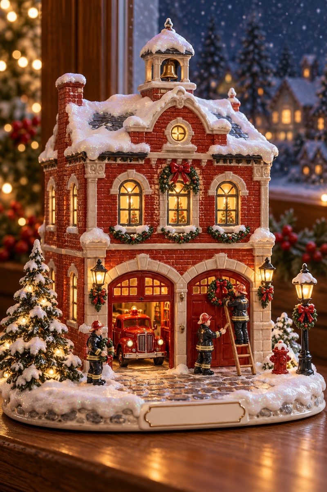</td>
  </tr>
  <tr>
    <td align="center">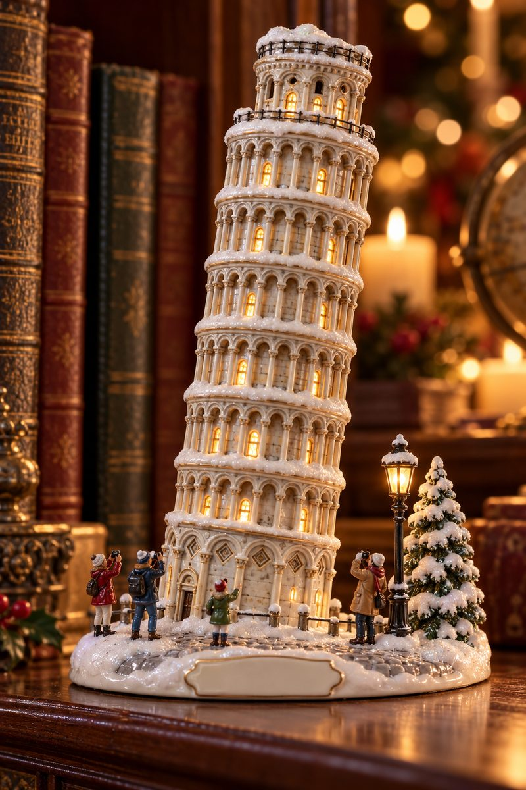</td>
    <td align="center"></td>
    <td align="center">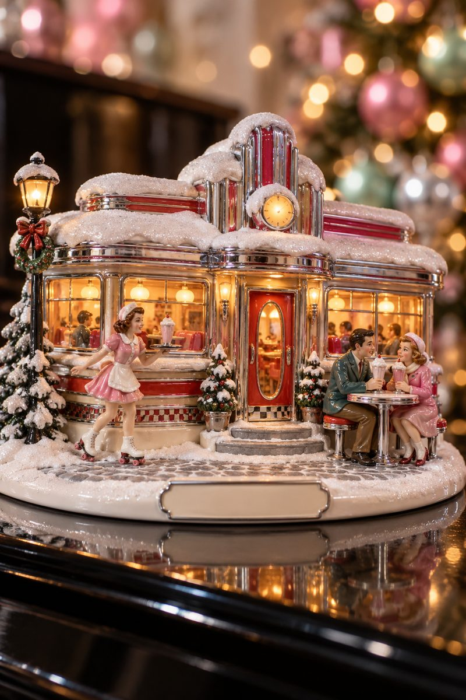</td>
  </tr>
</table>

<p align="center">
  <a href="https://promptbase.com/profile/bentleyartdesign?via=bentleyartdesign"><b>Get Porcelain Village Replicas on PromptBase &rarr;</b></a><!-- TODO(promptbase-links): porcelain prompt URL -->
</p>

---

## Free skills

Two small, genuinely useful Agent Skills, free under the MIT licence. They are lite versions on
purpose: each does one job well, runs on the Python standard library and tells you where the full
tools are when you need more.

### wcag-contrast-check

Give it hex colors; get a WCAG 2.x contrast matrix with AA and AAA results for normal and large
text, and every failing pair flagged, lowest contrast first. Ratios are truncated, never rounded up,
so a "pass" is always a real pass.

<p align="center">
  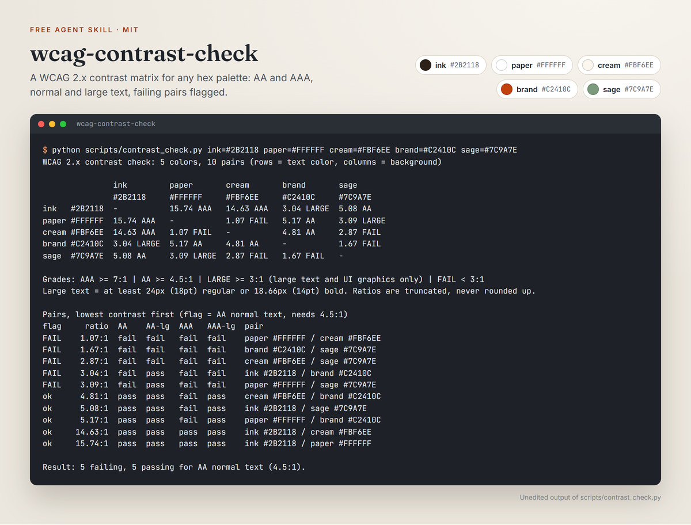
</p>

```bash
cd skills/wcag-contrast-check
python scripts/contrast_check.py ink=#1A1A2E paper=#FFFFFF brand=#E94560
python scripts/contrast_check.py --json examples/palette.json --format markdown --strict
```

Ask your agent: *"Check the contrast of my palette: #1A1A2E, #FFFFFF, #E94560. Is it AA?"*
&nbsp;·&nbsp; [SKILL.md](skills/wcag-contrast-check/SKILL.md) &nbsp;·&nbsp; [ZIP](dist/wcag-contrast-check.zip)

> Want logos, color scales, Tailwind tokens and guidelines, with failing pairs fixed for you?
> &rarr; [Design System Starter on Agensi](https://www.agensi.io/skills/design-system-starter-logos-wcag-palette-tailwind-tokens)

### habit-tracker-pdf

One printable monthly habit tracker page as a crisp vector PDF (US Letter): your title, the right
month with real weekday headers and shaded weekends, up to 20 habits with a circle for every day, a
totals column and notes boxes.

<p align="center">
  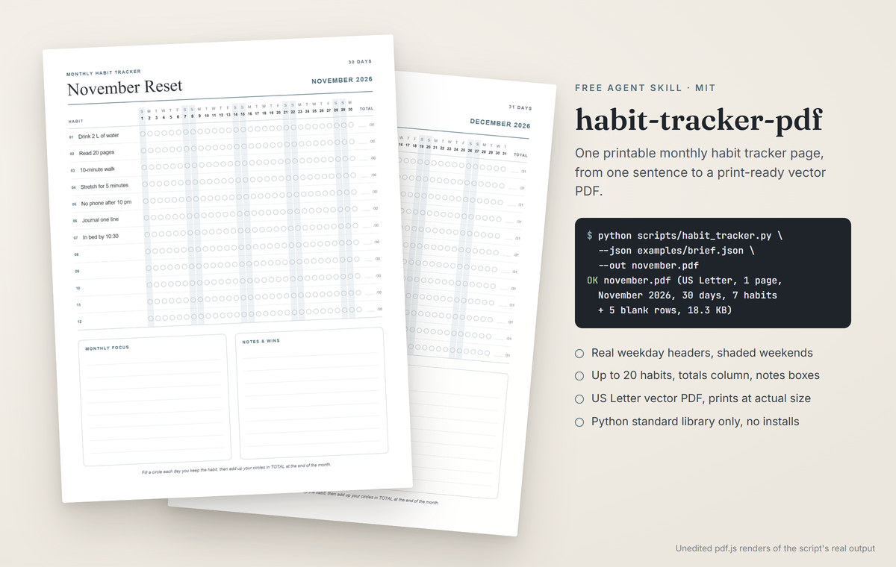
</p>

```bash
python skills/habit-tracker-pdf/scripts/habit_tracker.py \
  --month 11 --year 2026 --title "November Reset" \
  --habits "Drink 2 L of water" "Read 20 pages" "10-minute walk" \
  --out november.pdf
```

Ask your agent: *"Make me a habit tracker for November 2026 with: drink water, read 20 pages, walk."*
&nbsp;·&nbsp; [Sample PDF](assets/free/habit-tracker-sample-2026-11.pdf) &nbsp;·&nbsp; [SKILL.md](skills/habit-tracker-pdf/SKILL.md) &nbsp;·&nbsp; [ZIP](dist/habit-tracker-pdf.zip)

> Need full planner packs in 9 styles, A4 + Letter, and a listing to sell them?
> &rarr; [Digital Product Factory on Agensi](https://www.agensi.io/skills/digital-product-factory-print-ready-pdf-packs-listing)

### Install the free skills

**Claude Code.** Copy a skill folder into your personal skills folder (all projects) or into
`.claude/skills/` inside one project:

```bash
git clone https://github.com/DuncanBentley/bentley-art-design.git
mkdir -p ~/.claude/skills
cp -r bentley-art-design/skills/wcag-contrast-check ~/.claude/skills/
cp -r bentley-art-design/skills/habit-tracker-pdf ~/.claude/skills/
```

```powershell
# Windows PowerShell
git clone https://github.com/DuncanBentley/bentley-art-design.git
New-Item -ItemType Directory -Force "$HOME\.claude\skills" | Out-Null
Copy-Item -Recurse bentley-art-design\skills\wcag-contrast-check "$HOME\.claude\skills\"
Copy-Item -Recurse bentley-art-design\skills\habit-tracker-pdf "$HOME\.claude\skills\"
```

**Claude apps (web and desktop).** Download a ZIP from [`dist/`](dist) and upload it in Claude's
Skills settings (code execution must be enabled).

**Other agents** that support the SKILL.md standard (Codex CLI, Cursor, Gemini CLI and others): copy
the skill folder into that agent's skills directory.

**No agent?** Both scripts run on their own with Python 3.8 or newer. Run them with `--help`.

---

## License

- **Free skills**: everything in [`skills/`](skills) and the ZIPs in [`dist/`](dist) is MIT licensed. See [LICENSE](LICENSE).
- **Everything else** (showcase images, screenshots, product names and the Bentley Art Design branding) is &copy; 2026 Duncan Bentley, all rights reserved.
- **Paid products are not included** in this repository: the PromptBase prompts and the paid Agensi skills are sold only on their marketplaces.

## Feedback

Found a bug in a free skill, or have an idea for one? [Open an issue](../../issues). See
[CONTRIBUTING.md](CONTRIBUTING.md).

<p align="center">
  <sub>&copy; 2026 Duncan Bentley &middot; Bentley Art Design &middot;
  <a href="https://promptbase.com/profile/bentleyartdesign?via=bentleyartdesign">PromptBase</a> &middot;
  <a href="https://www.agensi.io/creators/duncan-bentley">Agensi</a> &middot;
  <a href="https://github.com/DuncanBentley">GitHub</a></sub>
</p>
